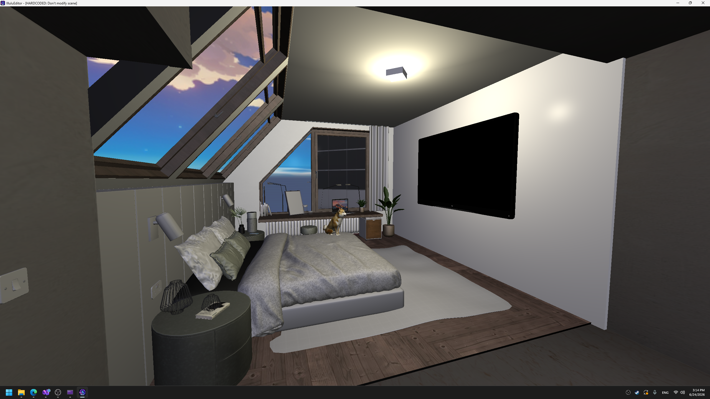
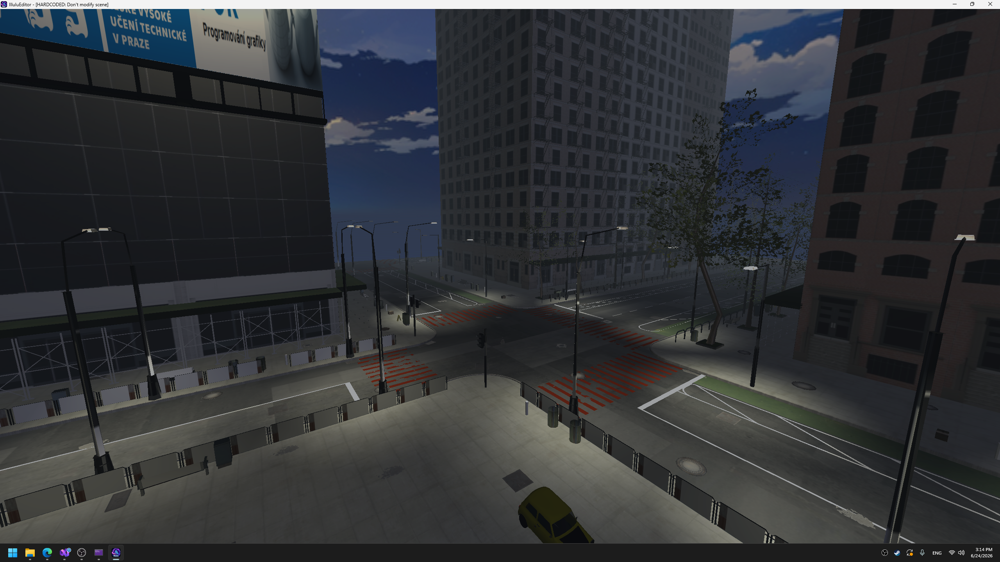
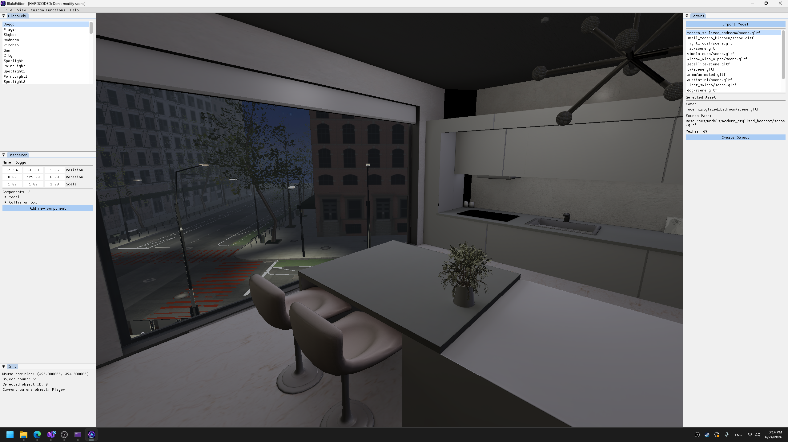

# IlluluOld - OpenGL

Illulu is a small 3D engine and scene editor written in modern C++. It was created as a learning project for experimenting with real-time rendering, scene editing, component-based design, asset loading and editor tooling.

The project combines an OpenGL renderer with a Dear ImGui editor. You can import 3D models, build a scene from objects and components, configure cameras and lights, preview the result in real time, and save the scene into a custom `.ill` file.

> **Project status:** Illulu was developed as an educational project and is ***NO LONGER MAINTAINED***. The main editor and rendering features work, but some systems are still intentionally simple and may contain demo-specific behavior.

## Features

- Real-time 3D rendering with OpenGL 3.3 Core.
- Dockable editor interface built with Dear ImGui.
- Scene hierarchy with object selection, creation, duplication, renaming, and deletion.
- Inspector for editing object transforms and components.
- Importing common 3D model formats through Assimp.
- Asset browser for spawning imported models into the scene.
- Perspective and orthographic cameras.
- Directional, point, and spot lights.
- Diffuse and specular materials with texture support.
- Opaque, masked, and transparent materials.
- Skyboxes using cubemap textures.
- Linear and exponential distance fog.
- Animated texture atlases.
- Scrolling or floating texture coordinates.
- Axis-aligned collision boxes.
- Collision-box debug visualization.
- Mouse-based object picking.
- Optional back-face culling and normal visualization.
- Runtime shader recompilation from the editor.
- Saving and loading scenes using the custom `.ill` scene format.

## Preview

[**Link to a short preview of engine on YouTube**](https://youtu.be/TkzZUuseB2A)

## Editor overview

Illulu uses a simple editor layout inspired by common game engines:

- **Hierarchy** displays the objects currently present in the scene.
- **Inspector** edits the selected object's transform and components.
- **Assets** imports models and creates scene objects from them.
- **Info** shows basic runtime and scene information.
- **Menu bar** provides scene loading, saving, rendering options, and debugging tools.

A typical workflow looks like this:

1. Import a model in the **Assets** panel.
2. Double-click the imported asset to create an object.
3. Select the object in the **Hierarchy** panel.
4. Change its position, rotation, and scale in the **Inspector**.
5. Add components such as lights, cameras, fog, animation, or collision boxes.
6. Save the completed scene as an `.ill` file.

## Architecture

The application is divided into a few small core systems:

- `Window` creates the GLFW window and receives keyboard and mouse events.
- `Input` stores the current keyboard and mouse state.
- `Scene` owns imported models, scene objects, and their components.
- `Renderer` renders the active scene using OpenGL.
- `EditorApp` runs the main loop and adds the Dear ImGui editor interface.

Each scene object has a transform and a collection of components. Components determine what the object represents or how it behaves. For example, an object can contain a model renderer, camera, light, collision box, fog settings, or texture animation.

The renderer reads the active camera and the renderable components from the scene, uploads lighting and material data to the shaders, and draws the scene every frame. The editor works directly with the same scene data, so changes made in the Inspector are immediately visible in the viewport.

## Controls

### Editor

| Input | Action |
|---|---|
| `E` | Switch between editor mode and runtime camera mode |
| `T` | Select the object under the mouse cursor |
| Right-click an object | Open object actions in the Hierarchy |
| Double-click a model asset | Create an object from the selected model |

### Runtime camera

| Input | Action |
|---|---|
| `W`, `A`, `S`, `D` | Move the active camera |
| Mouse | Rotate the active perspective camera |
| Left `Shift` | Move faster |
| Left `Ctrl` | Move slower |
| `F` | Interact with supported objects in the demo scene |

Some runtime interactions and camera shortcuts are currently tied to the included demo scene and are not yet part of a general scripting system.

## Dependencies

Illulu was developed for Windows using **Visual Studio 2026**.

Required tools and libraries:

- Visual Studio 2026 (will probabilty work on older versions too).
- Windows 10 or Windows 11 SDK.
- A compiler with C++23 support.
- OpenGL 3.3 or newer.
- [GLFW](https://www.glfw.org/) for window creation and input.
- [GLAD](https://glad.dav1d.de/) for loading OpenGL functions.
- [GLM](https://github.com/g-truc/glm) for vectors and matrices.
- [Assimp](https://github.com/assimp/assimp) for importing 3D models.
- [Dear ImGui](https://github.com/ocornut/imgui) for the editor interface.
- [Native File Dialog Extended](https://github.com/btzy/nativefiledialog-extended) for file dialogs.
- [stb_image](https://github.com/nothings/stb) for loading textures and icons.

The current code uses the Win32 API for native message boxes, so the project should be treated as Windows-only in its present form, but will very small modifications can be made crossplatform.

## Building with Visual Studio 2026

1. Open the Illulu solution or project in Visual Studio 2026.
2. Build entire solution.
3. Run the program. (Make sure *IlluluEditor* project is set as Startup project)
4. The post build script (copies necessary dlls and resources into the build folder) to build folder should do all the necessary work. If not, try to run it yourself with /Debug or /Release depending on your configuration. 

5. (**Optional**) If you want to examine the demo scene, you can find it in Resources/Scenes/Semestral.ill

## Scene files: custom human-readable format 

Scenes are stored in a custom text-based format using the `.ill` extension. A scene file contains:

- imported model paths;
- objects and their transforms;
- attached components and their settings;
- the currently active camera.

The format is intentionally simple and human-readable for debugging reasosn. It is suitable for the current project, although it does not yet provide the robustness or versioning expected from a production asset format.

## Attention: 

Assets used in the demo scene are not my and are freely attainable.